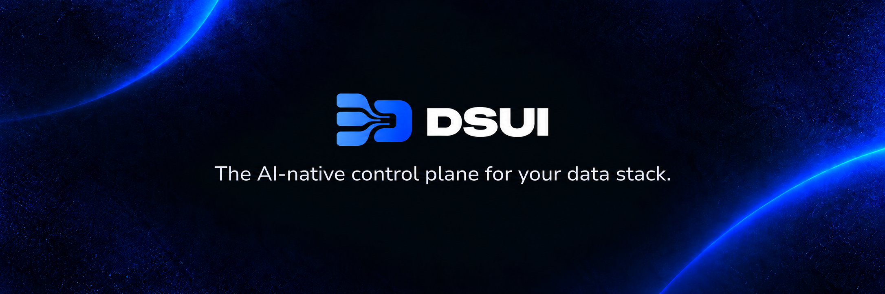
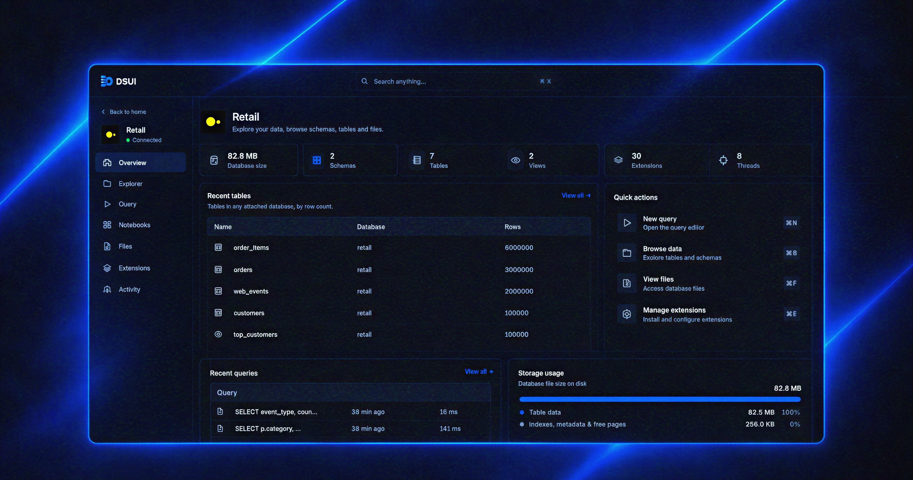
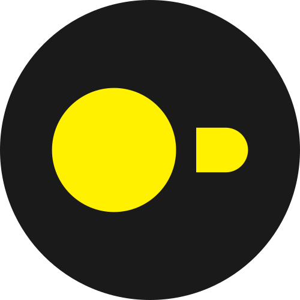

[Website](https://dsui.northgraindata.com) · [Live Demo](https://dsui.northgraindata.com/demo) · [Documentation](https://dsui.northgraindata.com/docs) · [Discord](https://discord.gg/6vgtDbVggc)

# The AI-native control plane for your data stack.

Connect your data tools and manage them from one place. Explore your infrastructure, run operations, and work across services with AI that understands your stack.




## One control plane across your stack

Connect tools through adapters, run service operations, and use DSUI Agent to work across your connected stack. Extend the platform with plugins and SDKs.

## Get started

Run DSUI on your host for local development and project files:

```bash
npx @northgraindata/dsui
```

DSUI loads `./dsui.yaml` when present and keeps local state in
`~/.local/share/dsui`.

The first local run also generates `~/.local/share/dsui/.master-key` for
encrypting connections added through the UI. Keep it with the local data
directory; set `DSUI_MASTER_KEY` explicitly for controlled deployments.

## Docker deployment

Use Docker when you want an isolated, reproducible deployment. It connects to
services reachable from the container. If an adapter requires an executable or
runtime, provide it in the image used to run DSUI.

## One setup, across your stack

Configure a DuckDB database in `dsui.yaml`:

```yaml
adapters:
  duckdb:
    source: git
    repository: "git+https://github.com/northgraindata/dsui"
    ref: main
    path: packages/adapter-duckdb

services:
  - id: warehouse
    adapter: duckdb
    name: Analytics warehouse
    connection:
      method: file
      path: /data/warehouse.duckdb
```

Run DSUI alongside it in `docker-compose.yml`:

```yaml
services:
  dsui:
    image: ghcr.io/northgraindata/dsui:latest
    ports:
      - "4192:4192"
    environment:
      DSUI_CONFIG: /etc/dsui/dsui.yaml
    volumes:
      - ./dsui.yaml:/etc/dsui/dsui.yaml:ro
      - dsui-data:/data

volumes:
  dsui-data:
```

Start the workspace:

```bash
docker compose up -d
```

Open [http://localhost:4192](http://localhost:4192). DSUI downloads and builds the configured DuckDB adapter, then opens the database file in the persistent `/data` volume. Add your other services to the same `dsui.yaml` and Compose network.

## Adapters

Connect Apache Airflow, dbt, PostgreSQL, ClickHouse, S3-compatible storage such as MinIO, and DuckDB through adapters that bring service-specific capabilities into DSUI.

|                                                       |                                               |                                                             |                                                       |                                                   |                                                |                                                       |
| ----------------------------------------------------- | --------------------------------------------- | ----------------------------------------------------------- | ----------------------------------------------------- | ------------------------------------------------- | ---------------------------------------------- | ----------------------------------------------------- |
|  |  |  |  |  |  |  |


**Need another tool?**
The TypeScript [Adapter SDK](https://dsui.northgraindata.com/docs/adapter-sdk/overview) lets you build custom integrations for internal services and other tools.

## Plugins and custom capabilities

Install plugins to extend DSUI beyond connected services. Use the TypeScript [Plugin SDK](https://dsui.northgraindata.com/docs/plugin-sdk/overview) to build custom pages, actions, and workflows tailored to your infrastructure.

## Self-hosted deployment

The official container keeps its local state in `/data`. It does not need a separate database or control plane. The official container image is published through GitHub Container Registry:

```bash
docker pull ghcr.io/northgraindata/dsui:latest
```

## Community

Join the [DSUI Discord](https://discord.gg/6vgtDbVggc) to ask questions, share your setup, discuss integrations, and help shape what we build next.

## Contributing

Contributions are welcome. Start with [your first contribution](./CONTRIBUTING.md#your-first-contribution), browse [good first issues](https://github.com/northgraindata/dsui/issues?q=is%3Aissue%20is%3Aopen%20label%3A%22good%20first%20issue%22), or explore [help wanted](https://github.com/northgraindata/dsui/issues?q=is%3Aissue%20is%3Aopen%20label%3A%22help%20wanted%22).

## License

DSUI is developed by [Northgrain Data](https://northgraindata.com) and is available under the [Apache License 2.0](./LICENSE).
